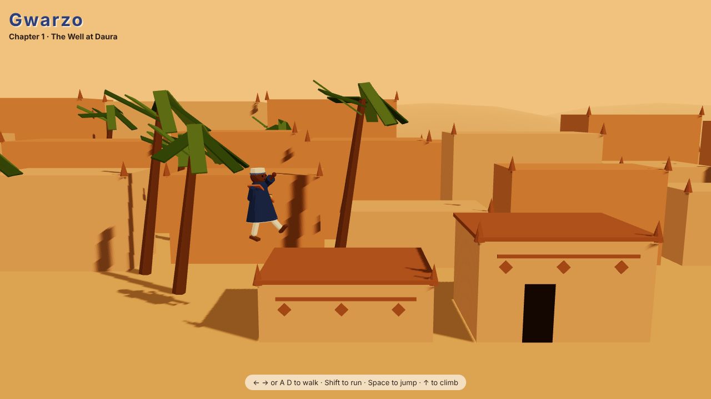

# Gwarzo

A time-bending 3D puzzle adventure through the legends of ancient Hausaland, for the web and phones.

You play a griot's apprentice in old Northern Nigeria who learns to rewind, hold and hasten time with a talking
drum (kalangu), and uses it to settle battles, defeat monsters, talk warlords down and stop disasters. Each chapter
is built on a real legend or historical event.

**Chapter 1: The Well at Daura**, after the legend of Bayajidda and the snake in the well.



## Where it is now

Weeks 1 and 2 of the first playable: walk, run, jump and climb along a street in Daura to the well, and bend time
with the drum to get past two obstacles.

- **The old bridge** gives way as you near the gully. Rewind it back into place, hold it still, and cross.
- **The hoist** up the courtyard wall is slow. Hasten it, hold it where you need it, and ride it up.

- The hero and the whole town are built in code from simple shapes with toon shading. There are no model or
  animation files: the walk, run, jump, climb and idle animations are computed every frame from the hero's movement.
- Movement runs on a fixed 60 Hz step over plain data (`src/game/physics.ts`), so it can be tested.
- Every time object's shape is a pure function of its own clock (`src/game/time.ts`). The drum only changes how
  fast, and which way, a clock runs, so a rewind is exact however long you hold it.
- The drum sound is synthesised in the browser: its pitch bends down to rewind, up to hasten.
- Keyboard on desktop, on-screen buttons on phones.

Next: more puzzles leading to the well, a scene-wide rewind, then the snake.

## Run it

Needs Node.js 22 or newer.

```bash
npm install
npm run dev
```

Then open the address Vite prints. `?start=40` drops the hero further along the street, for testing, and
`?debug` puts the live game state on `window.gwarzo`.

| Command | What it does |
| --- | --- |
| `npm run dev` | the game with live reload |
| `npm test` | the unit tests (Vitest) |
| `npm run typecheck` | TypeScript, no output |
| `npm run build` | typecheck, then a production build in `dist/` |

## Controls

| Desktop | Phone | Action |
| --- | --- | --- |
| ← → or A D | ◀ ▶ | walk |
| Shift | Run | run |
| Space | Jump | jump (hold for higher) |
| ↑ / ↓ or W / S | ▲ ▼ | climb a rope or ladder |
| Q (hold) | ⟲ | drum: rewind the nearest time object |
| E | ⏸ | drum: hold it still (again to let go) |
| R (hold) | ⏩ | drum: hasten it |

## Code map

| Path | What's there |
| --- | --- |
| `src/game/level.ts` | the chapter's layout: everything solid, ropes and ladders, the goal |
| `src/game/physics.ts` | hero movement, pure functions, with tests beside it |
| `src/game/time.ts` | the drum and time objects: clocks, shapes over time, rewind, hold, hasten |
| `src/game/world.ts` | one tick of the chapter: drum, clocks, riding along, hero |
| `src/game/input.ts` | keyboard and touch folded into one input |
| `src/world/Hero.tsx` | the code-built hero and its procedural animation |
| `src/world/Daura.tsx` | the town, built from the level data plus a background skyline |
| `src/world/TimeThings.tsx` | the bridge and hoist, with a glow for what the drum is doing to them |
| `src/world/Game.tsx` | the game loop, lights and side-on follow camera |
| `src/world/toon.ts` | shared toon materials and the chapter's palette |
| `src/ui/` | on-screen touch controls and the synthesised drum sound |
